# 🌊 Underwater Image Restoration and Marine Life Detection: An Investigation into Detection-Driven Enhancement

**Milestone 2: Project Design, System Architecture & Empirical Progress Report**  
*Semester 5 Project — Academic Year 2026*

---

## 👥 Project & Group Metadata

| Attribute | Details |
| :--- | :--- |
| **Project Title** | **Underwater Image Restoration and Marine Life Detection: An Investigation into Detection-Driven Enhancement** |
| **Course / Level** | Semester 5 Capstone Project |
| **Group Leader** | **Gyanendra Prakash** (Registration No: `S24CSEU0771`) |
| **Group Member** | **Goutam Mittal** (Registration No: `S24CSEU0785`) |
| **Group Member** | **Dhruv Gupta** (Registration No: `S24CSEU0819`) |
| **Group Member** | **Ankit Gupta** (Registration No: `S24CSEU1062`) |
| **Repository Scope** | `e:\sem5_project` — Deep Visual State Space Models (Mamba) for Underwater Enhancement & Detection |
| **Primary Benchmark** | **Large-Scale Underwater Image (LSUI)** Dataset (4,279 image pairs) |
| **Hardware Platform** | NVIDIA GeForce RTX 4060 Laptop GPU (CUDA 12.x, PyTorch 2.x, Windows 11) |

---

## 📑 Executive Overview

This report constitutes the complete **Milestone 2: Project Design** submission, directly continuing from the problem definition, existing-systems review, and feasibility analysis established in **Milestone 1**.

While Milestone 1 identified the fundamental optical physics governing underwater image degradation (wavelength-dependent attenuation, forward/backward scattering, low contrast, and color casts) and pinpointed the critical gap between human-perceptual enhancement and downstream marine life detection, **Milestone 2 specifies the technical blueprint and presents working empirical models trained to resolve these challenges.**

Specifically, this report documents:
1. **Formal Objectives & Step-by-Step Methodology Pipeline** addressing each identified gap.
2. **Mandatory Overall System Architecture Diagram** with rigorous data/control flow specifications.
3. **Relevance of Algorithms & Techniques**, providing algorithmic justifications against CNN, GAN, and Transformer baselines.
4. **Empirical Progress & Models Trained**: Full technical implementation and local training of two state-of-the-art Visual State Space Models (**WaterMamba** and **Hero-Mamba**).
5. **Architectural Innovations & Engineering Modifications**: Adaptation of selective scan mechanisms for separable 2D spatial coordinate scanning ($H$-sweep and $W$-sweep), dual-domain spatial-spectral FFT fusion, physical optical priors ($\mathbf{B}_\infty$), and native-resolution bilateral ratio-map inference.
6. **Result Shifts & Performance Metrics**: Benchmark comparisons across 429 unseen test images demonstrating a clear **Fidelity vs. Efficiency Trade-off** (+3.53 dB PSNR advantage in WaterMamba vs. 66.1% parameter reduction and $3.04\times$ latency speedup in Hero-Mamba).

---

# 1. Objectives & Methodology of Proposed Work

## 1.1 Problem Statement Recall & Identified Gaps from Milestone 1

Underwater optical imaging suffers from severe medium-induced distortions governed by the **Beer-Lambert Law** and particle scattering:
- **Selective Wavelength Absorption**: Longer wavelengths ($\text{Red } \lambda \approx 620-750\text{ nm}$) suffer the highest attenuation, decaying to near extinction within $3-5\text{ meters}$. Shorter wavelengths ($\text{Blue } \approx 450-495\text{ nm}$ and $\text{Green } \approx 495-570\text{ nm}$) penetrate deeper, creating heavy blue-green casts.
- **Forward & Backward Scattering**: Suspended particulate matter (*marine snow*, plankton, minerals) scatters reflected light, blurring high-frequency textures (forward scattering) while reflecting ambient light directly into the lens as a veiling haze (backscatter), crushing dynamic range.

### Critical Gaps Identified in Existing Literature:
1. **Quadratic Computational Bottleneck of Vision Transformers**: Recent state-of-the-art restorers (e.g., Restormer, SwinIR) rely on self-attention mechanisms with quadratic complexity $\mathcal{O}(H^2W^2)$, resulting in massive GPU memory footprints ($>16\text{ GB}$) and sluggish inference ($>1,500\text{ ms}$), prohibiting real-time deployment on Autonomous Underwater Vehicles (AUVs) and edge robotics.
2. **Limited Receptive Fields of Classical CNNs**: Early networks (e.g., Water-Net) rely on localized convolution kernels, failing to capture global scene illumination gradients and non-uniform underwater water-type transitions.
3. **Hallucinatory Artifacts of Pure GANs**: While models like FUnIE-GAN provide fast inference, adversarial training frequently introduces synthetic high-frequency artifacts and structural distortions detrimental to downstream biological detection.
4. **Decoupling of Perceptual Quality and Downstream Detection**: Conventional pipelines optimize solely for human perceptual metrics (PSNR, SSIM), which recent studies (Awad et al., 2024; Saleem et al., 2025; Cao et al., 2026) show does *not* consistently improve downstream object detection (mAP) for marine species.

---

## 1.2 Specific, Measurable Objectives

The project is structured into **five logically ordered, measurable objectives**:

```
[Objective 1: Dataset & Baseline] ──► [Objective 2: Visual SSM Design] ──► [Objective 3: Physics Priors] 
                                                                                   │
                                      [Objective 5: Detection Benchmark] ◄── [Objective 4: Comparative Study]
```

1. **Objective 1 (Foundational Data & Integrity Protocol)**:
   - Establish a reproducible, leak-free benchmark split on the **LSUI dataset** ($4,279$ real-world paired underwater images: $80\%$ Train [$3,423$], $10\%$ Validation [$428$], $10\%$ Test [$429$]).
   - Quantify baseline degradation metrics on raw inputs (baseline PSNR $\approx 15.6\text{ dB}$, SSIM $\approx 0.72$, red-channel mean intensity $<70/255$).
2. **Objective 2 (Linear-Complexity Visual State Space Architecture)**:
   - Formulate and implement **Selective State Space Models (Mamba S6)** tailored for computer vision restoration, achieving **strictly linear complexity $\mathcal{O}(L)$** with respect to sequence length, overcoming Transformer quadratic bottlenecks.
3. **Objective 3 (Dual-Domain Spectral & Optical Physical Priors)**:
   - Engineer physical-domain grounding by incorporating a **Fast Fourier Transform (FFT) spectral branch** (isolating frequency amplitude and phase) and an optical transmission model ($J = I \cdot t + \mathbf{B}_\infty(1 - t)$) with learnable background light priors ($\mathbf{B}_\infty$).
4. **Objective 4 (Empirical Multi-Model Training & Benchmark Comparison)**:
   - Train and validate two distinct Mamba-based paradigms (**WaterMamba** and **Hero-Mamba**) under uniform local GPU conditions on the LSUI dataset.
   - Achieve target restoration thresholds: $\text{PSNR} > 23.0\text{ dB}$, $\text{SSIM} > 0.89$, and test inference latency $< 300\text{ ms}$ per frame for edge feasibility.
5. **Objective 5 (Native-Resolution Color/Illumination Transfer & Detection Alignment)**:
   - Deploy an aspect-ratio-preserving bilateral ratio-map inference pipeline to enhance uncropped, arbitrary-resolution underwater images ($1280\times 1024$, $640\times 360$, $400\times 300$).
   - Formulate the downstream evaluation framework to quantify object detection shifts ($\Delta\text{mAP}$) when feeding restored feeds into marine life detectors (YOLOv8 fine-tuned on DUO/Brackish).

---

## 1.3 Step-by-Step Methodology Pipeline

```
┌─────────────────────────────────────────────────────────────────────────────────────────────┐
│                                   STEP-BY-STEP PIPELINE                                     │
├─────────────────────┬───────────────────────────────────────────────────────────────────────┤
│ 1. Data Collection  │ • Large-Scale Underwater Image (LSUI) Dataset (Li et al., 2021)       │
│                     │ • 4,279 high-fidelity paired images (input degraded + ground truth)   │
│                     │ • Formats: 3-channel 8-bit RGB; resolutions from 256x256 to 1280x1024 │
├─────────────────────┼───────────────────────────────────────────────────────────────────────┤
│ 2. Preprocessing &  │ • Verification: 0 corrupted files, 100% 1-to-1 pair matching          │
│    Patch Strategy   │ • Data Splitting: Seed-fixed (42) Train (3,423), Val (428), Test (429)│
│                     │ • Training: Random dynamic crop of 256x256 patches (retains sensor SNR│
│                     │   and edge sharpness without warping aspect ratios)                   │
│                     │ • Evaluation: Native full-resolution inference via Bilateral Ratio Map│
├─────────────────────┼───────────────────────────────────────────────────────────────────────┤
│ 3. Proposed Systems │ • Model A (WaterMamba): Hierarchical U-Net with SCOSS Blocks          │
│    / Model Design   │   (Spatial Omnidirectional Selective Scan SOSS + CCOSS + MSFFN)       │
│                     │ • Model B (Hero-Mamba): Dual-Domain Stem (RGB + FFT) + SS2D           │
│                     │   + BackgroundLightPrior (B_inf) + ColorFusion + MS-Fusion            │
├─────────────────────┼───────────────────────────────────────────────────────────────────────┤
│ 4. Implementation   │ • Framework: PyTorch 2.x, Torchvision, CUDA 12.x                      │
│    Environment      │ • Compute: NVIDIA GeForce RTX 4060 Laptop GPU (8 GB VRAM)             │
│                     │ • Optimization: AdamW (lr=2e-4, cosine decay to 1e-6, weight decay=1e-4)│
│                     │ • Logging: Custom multi-thread TeeLogger tracking step/epoch telemetry│
├─────────────────────┼───────────────────────────────────────────────────────────────────────┤
│ 5. Testing &        │ • Full-Reference Metrics: Peak Signal-to-Noise Ratio (PSNR), SSIM    │
│    Validation Plan  │ • Non-Reference Physical Metrics: RGB Channel Intensity Histograms   │
│                     │ • Efficiency Metrics: Parameters (M), Latency (ms/img), Throughput    │
│                     │ • Unseen Evaluation: 429 LSUI test images at 100% native resolutions  │
├─────────────────────┼───────────────────────────────────────────────────────────────────────┤
│ 6. Expected Outcome │ • SOTA linear-time underwater restoration engine                      │
│                     │ • Quantitative trade-off map between fidelity and robotics latency    │
│                     │ • Restored feeds providing enhanced input for marine life detection   │
└─────────────────────┴───────────────────────────────────────────────────────────────────────┘
```

---

# 1.4 Overall Architecture Diagram — Mandatory Deliverable

The overall architecture of the proposed underwater enhancement and detection system is structured into four interconnected functional tiers:
1. **Input & Sensing Layer**: Acquires degraded underwater images and decomposes them across spatial and spectral representations.
2. **Dual-Domain Feature Processing Tier**: Extracts complementary spatial structural cues and global frequency illuminant features via selective state space engines.
3. **Core Physics-Informed Modeling Tier**: Fuses physical background light priors ($\mathbf{B}_\infty$) and optical transmission equations ($t$) with multi-scale convolutional feed-forward networks.
4. **Hierarchical Decoder & Output Layer**: Restores color fidelity via global residual connections and high-resolution bilateral ratio maps, outputting restored frames for human visualization and downstream marine life detection.

```mermaid
graph TD
    %% TIER 1: INPUT SOURCE
    subgraph T1["1. INPUT SOURCE & DECOMPOSITION LAYER"]
        IN["Raw Degraded Underwater Image<br/>I(x) ∈ ℝ^(3 × H × W)<br/>[Color Cast, Attenuation, Veiling Haze]"]
        IN --> SPLIT1["RGB Spatial Domain<br/>I_rgb ∈ ℝ^(3 × H × W)"]
        IN --> FFT["2D Fast Fourier Transform<br/>FFT2(I) = Log(1 + |Amp|) || Angle<br/>I_fft ∈ ℝ^(2 × H × W)"]
    end

    %% TIER 2: SELECTIVE STATE SPACE PROCESSING
    subgraph T2["2. DUAL-DOMAIN SSM PROCESSING LAYER"]
        SPLIT1 --> SS2D_RGB["Spatial Selective Scan (SS2D_RGB)<br/>Separable 2D Omnidirectional Sweeps<br/>Horizontal (W) & Vertical (H) S6 SSMs"]
        FFT --> SS2D_FFT["Spectral Selective Scan (SS2D_FFT)<br/>Frequency-Space Omnidirectional S6<br/>Haze & Illumination Field Modeling"]
        SS2D_RGB --> FUSE_STEM["Dual-Domain Stem Fusion<br/>Concat(F_rgb, F_fft) ∈ ℝ^(5 × H × W)"]
        SS2D_FFT --> FUSE_STEM
        FUSE_STEM --> MSF_STEM["Multi-Scale Stem Fusion (MS-Fusion)<br/>Parallel DW-Convs (1x1, 3x3, 5x5)"]
        MSF_STEM --> STEM_DOWN["Stem Downsampling (Conv 3x3, stride=2)<br/>F_0 ∈ ℝ^(C_0 × H/2 × W/2)"]
    end

    %% TIER 3: CORE HIERARCHICAL ENCODER & PHYSICAL PRIORS
    subgraph T3["3. CORE HIERARCHICAL SYSTEM & PHYSICAL PRIORS"]
        STEM_DOWN --> ENC1["Encoder Block 1 (C_1=64)<br/>LN + SS2D + MS-Fusion + Downsample"]
        ENC1 --> ENC2["Encoder Block 2 (C_2=128)<br/>LN + SS2D + MS-Fusion + Downsample"]
        ENC2 --> ENC3["Encoder Block 3 (C_3=256)<br/>LN + SS2D + MS-Fusion + Downsample (Bottleneck)"]

        IN --> PRIOR["Physics Background Light Prior<br/>B_inf = Est(I) + b_l Learnable Bias<br/>Multi-Scale Spatial Projections"]
        
        ENC1 -.-> CF1["ColorFusion 1<br/>J_1 = F_1 ⊙ t_1 + B_1 ⊙ (1 - t_1)"]
        ENC2 -.-> CF2["ColorFusion 2<br/>J_2 = F_2 ⊙ t_2 + B_2 ⊙ (1 - t_2)"]
        ENC3 -.-> CF3["ColorFusion 3<br/>J_3 = F_3 ⊙ t_3 + B_3 ⊙ (1 - t_3)"]
        PRIOR --> CF1
        PRIOR --> CF2
        PRIOR --> CF3
    end

    %% TIER 4: DECODER & OUTPUT RECONSTRUCTION
    subgraph T4["4. HIERARCHICAL DECODER & OUTPUT TIER"]
        ENC3 --> DEC3["Decoder Block 3<br/>Bilinear Upsample (2x) + Conv 3x3 + BN + SiLU"]
        CF3 --> DEC3
        DEC3 --> DEC2["Decoder Block 2<br/>Skip Connection Fusion with ColorFusion 2"]
        CF2 --> DEC2
        DEC2 --> DEC1["Decoder Block 1<br/>Skip Connection Fusion with ColorFusion 1"]
        CF1 --> DEC1
        DEC1 --> DEC0["Decoder Block 0 (C=16)<br/>Bilinear Upsample (2x) to Native Spatial Grid"]
        DEC0 --> OUT_CONV["Projection Head (Conv 3x3)"]
        OUT_CONV --> RES_ADD["Global Long Residual Addition<br/>Enhanced Patch = Out + I(x)"]
        IN --> RES_ADD
    end

    %% TIER 5: DUAL OUTCOMES
    subgraph T5["5. OUTPUT & DOWNSTREAM APPLICATION"]
        RES_ADD --> RATIO["Bilateral Ratio-Map Upsampler<br/>Ratio = (T_enh + ε) / (T_low + ε)<br/>Native Resolution Synthesis"]
        RATIO --> OUT_IMG["100% Native Resolution Restored Image<br/>[Balanced RGB, Dehazed, Sharp Edges]"]
        OUT_IMG --> DET["Downstream Marine Life Detection<br/>YOLOv8 Detection Engine (DUO / Brackish)<br/>Marine Species Classification & Localization"]
    end

    classDef inputTier fill:#e1f5fe,stroke:#0288d1,stroke-width:2px;
    classDef ssmTier fill:#ede7f6,stroke:#512da8,stroke-width:2px;
    classDef coreTier fill:#e8f5e9,stroke:#2e7d32,stroke-width:2px;
    classDef outTier fill:#fff3e0,stroke:#e65100,stroke-width:2px;
    classDef detTier fill:#fce4ec,stroke:#c2185b,stroke-width:2px;

    class IN,SPLIT1,FFT inputTier;
    class SS2D_RGB,SS2D_FFT,FUSE_STEM,MSF_STEM,STEM_DOWN ssmTier;
    class ENC1,ENC2,ENC3,PRIOR,CF1,CF2,CF3 coreTier;
    class DEC3,DEC2,DEC1,DEC0,OUT_CONV,RES_ADD outTier;
    class RATIO,OUT_IMG,DET detTier;
```



**Fig: Proposed System Architecture.**

---

### Detailed Architecture Walkthrough & Data/Control Flow

1. **Dual-Domain Input Decomposition**:
   - The degraded input image $\mathbf{I} \in \mathbb{R}^{3 \times H \times W}$ is simultaneously routed into the standard spatial RGB domain and a 2D Fast Fourier Transform (FFT) branch.
   - The spectral branch computes $\mathcal{F}(\mathbf{I}) = \mathbf{A} e^{j\mathbf{\Phi}}$, extracting logarithmic amplitude $\log(1 + |\mathbf{A}|)$ and phase $\mathbf{\Phi}$. The amplitude encapsulates global scene contrast and atmospheric/optical turbidity, while the phase retains high-frequency spatial edge distributions.
2. **Selective State Space Stem (SS2D)**:
   - The 3-channel RGB tensor and 2-channel spectral tensor are processed by independent spatial selective scan blocks (`SS2D_RGB` and `SS2D_FFT`).
   - Rather than flattening the 2D image into a long 1D sequence ($L = H \times W = 65,536$), our separable 2D scanning performs bidirectional continuous state updates along the height dimension ($H$) and width dimension ($W$) independently, reducing the recurrent sequence length to $\le 256$ tokens and maintaining native linear time $\mathcal{O}(H + W)$.
   - The spatial and frequency features are concatenated ($5$ channels) and refined through the `MS-Fusion` block before downsampling to channel dimension $C_0 = 32$.
3. **Hierarchical Encoder & Multi-Scale Convolutions**:
   - Three encoder stages progressively downsample spatial resolution while expanding feature channels ($32 \to 64 \to 128 \to 256$).
   - Each encoder block features Layer Normalization, an SS2D state space layer for global context capture, and an `MS-Fusion` block with parallel depthwise separable convolutions ($1 \times 1, 3 \times 3, 5 \times 5$) to preserve localized micro-textures (coral polyps, fish scales).
4. **Physical Prior Generation & ColorFusion Module**:
   - The input image is concurrently processed by the `BackgroundLightPrior` module to estimate the ambient illuminant vector $\mathbf{B}_\infty \in \mathbb{R}^{3 \times 1 \times 1}$ alongside learnable spatial parameter offsets $\mathbf{b}_l$.
   - At each hierarchical level, the `ColorFusion` module implements the underwater optical imaging equation:
     $$\mathbf{J}_i = \mathbf{F}_i \odot \mathbf{t}_i + \mathbf{B}_i \odot (1 - \mathbf{t}_i)$$
     where $\mathbf{t}_i = \sigma(\text{Conv}_{1\times 1}(\mathbf{F}_i))$ is the learned medium transmission map and $\mathbf{B}_i$ is the projected ambient illuminant. This explicitly forces the network to adhere to physical light transport laws rather than performing unconstrained color mapping.
5. **Decoder Reconstruction & Bilateral Ratio-Map Inference**:
   - The decoder symmetrically upsamples features using bilinear interpolation followed by convolutions and SiLU activations.
   - Long-range skip connections feed the physics-grounded `ColorFusion` features directly into corresponding decoder tiers.
   - A global residual skip connection adds the raw input $\mathbf{I}(x)$ to the output head, allowing the network to focus exclusively on learning the degradation residual $\mathbf{R}(x) = \mathbf{I}_{\text{GT}}(x) - \mathbf{I}(x)$.
   - For real-world deployment on arbitrary image resolutions, a **Bilateral Ratio Map** transfer computes:
     $$\mathbf{Ratio}_{\text{low}} = \frac{\mathbf{I}_{\text{enh, low}} + \epsilon}{\mathbf{I}_{\text{low}} + \epsilon}, \quad \mathbf{Ratio}_{\text{high}} = \text{Interpolate}(\mathbf{Ratio}_{\text{low}}, \text{size}=(H_{\text{orig}}, W_{\text{orig}}))$$
     $$\mathbf{I}_{\text{restored}} = \text{Clamp}(\mathbf{I}_{\text{orig}} \odot \mathbf{Ratio}_{\text{high}}, 0.0, 1.0)$$
     This eliminates aspect-ratio distortion and yields native-resolution restored imagery at real-time speeds.

---

# 2. Relevance of Algorithms & Techniques

## 2.1 Algorithm Justification Matrix

| Component / Algorithm | Alternative Considered | Why Alternative Was Rejected | Specific Fit to Underwater Image Data | Literature Reference | Expected Advantage |
| :--- | :--- | :--- | :--- | :--- | :--- |
| **Selective State Space Model (Mamba S6)** | **Self-Attention / Vision Transformers** (Restormer, SwinIR) | Quadratic complexity $\mathcal{O}(N^2)$ leads to out-of-memory errors on large images, heavy VRAM consumption ($>16\text{ GB}$), and latency $>1.5\text{ s}$ per frame. | Underwater degradation spans non-uniform global water columns requiring long-range context across the entire image grid. | Gu & Dao (2023); Zheng et al. (arXiv:2405.08419); Liu et al. (arXiv:2404.16266) | **Linear $\mathcal{O}(L)$ complexity**, $3-5\times$ faster inference, minimal memory footprint. |
| **Separable 2D Spatial Omnidirectional Scan (SOSS / SS2D)** | **Standard 1D Raster Flattened Scan** ($L = H \times W$) | Flattening $256 \times 256$ images creates a $65,536$-token sequence, causing GPU register spilling and requiring specialized proprietary C++ CUDA kernels unavailable natively on Windows. | Separates vertical ($H$) and horizontal ($W$) directional sweeps; sequence length stays $\le 256$, enabling ultra-fast PyTorch native execution. | Zheng et al. (2024); Liu et al. (2024) | Compatible with standard PyTorch on Windows/Linux; **$3.04\times$ latency speedup** without losing omnidirectional context. |
| **Dual-Domain Spectral Stem (Spatial + 2D FFT)** | **Pure Spatial Convolutions** | Spatial convolutions struggle to isolate diffuse backscatter veiling haze from sharp foreground subject edges. | Underwater backscatter concentrates predominantly in low-frequency spectral amplitude, while textures map to phase angles. | Liu et al. (arXiv:2404.16266); Mao et al. (2023) | Explicit decoupling of global haze and structural details; faster convergence. |
| **Physics-Informed Background Light & ColorFusion** | **Black-Box End-to-End Mapping** (U-Net, DnCNN) | Black-box models overfit to training distributions, frequently generating unphysical oversaturated artifacts or color blotches. | Strictly enforces the optical light attenuation model ($J = I \cdot t + B(1-t)$) at feature scale, ensuring physically grounded color rebalancing. | Akkaynak & Treibitz (2018); Liu et al. (2024) | Eliminates color hallucination; restores natural biological hues in deep water. |
| **Multi-Scale Depthwise Separable Convolutions (MS-Fusion)** | **Standard Dense Convolutions** ($3 \times 3, 5 \times 5$) | Standard convolutions suffer from quadratic parameter growth and excessive FLOPs without multi-scale receptive field capture. | Marine organisms range from microscopic coral polyp textures to large swimming pelagic fauna; requires multi-scale receptive fields ($1\times 1, 3\times 3, 5\times 5$). | Howard et al. (MobileNetV2); Zheng et al. (2024) | Captures fine-to-coarse textures with **66.1% fewer parameters**. |
| **Composite Multi-Term Loss (HeroLoss)** | **Pure Mean Squared Error (MSE / L2)** | MSE causes regression to the mean, generating overly smooth, blurry images that degrade edge detection. | Underwater images require joint pixel accuracy ($L_1$), structural edge preservation ($\mathcal{L}_{\text{SSIM}}$), and semantic feature coherence ($\mathcal{L}_{\text{VGG}}$). | Islam et al. (2020); Liu et al. (2024) | Sharp structural edge recovery essential for downstream bounding box detection. |

---

## 2.2 Mathematical Formulation of Algorithmic Core

### 1. The Continuous-Time State Space Engine (SSM)
The core physical formulation maps an input 1D signal sequence $u(t) \in \mathbb{R}$ to a continuous latent state representation $h(t) \in \mathbb{R}^N$ before projecting to output $y(t) \in \mathbb{R}$:
$$h'(t) = \mathbf{A} h(t) + \mathbf{B} u(t)$$
$$y(t) = \mathbf{C} h(t) + \mathbf{D} u(t)$$
where $\mathbf{A} \in \mathbb{R}^{N \times N}$ is the state transition matrix, $\mathbf{B} \in \mathbb{R}^{N \times 1}$ is the input projection vector, and $\mathbf{C} \in \mathbb{R}^{1 \times N}$ is the observation matrix.

### 2. Discretization via Zero-Order Hold (ZOH)
To execute on digital hardware with discrete step sizes $\Delta$, continuous parameters are discretized:
$$\overline{\mathbf{A}} = \exp(\Delta \mathbf{A})$$
$$\overline{\mathbf{B}} = (\Delta \mathbf{A})^{-1} (\exp(\Delta \mathbf{A}) - \mathbf{I}) \cdot \Delta \mathbf{B} \approx \Delta \mathbf{B}$$
The recurrent discrete state update is:
$$h_t = \overline{\mathbf{A}}_t h_{t-1} + \overline{\mathbf{B}}_t u_t$$
$$y_t = \mathbf{C}_t h_t + \mathbf{D} u_t$$

### 3. Selective Mechanism (S6 Core)
Unlike classical linear time-invariant (LTI) systems, Mamba introduces **input-dependent selectivity**:
$$\mathbf{B}_t = \text{Linear}_N(u_t), \quad \mathbf{C}_t = \text{Linear}_N(u_t), \quad \Delta_t = \text{Softplus}(\text{Linear}_1(u_t) + \text{bias})$$
This allows the state space model to dynamically adjust the memory retention rate $\Delta_t$ based on local image features, selectively filtering out scattering haze while propagating high-frequency marine boundaries.

---

# 3. Models Trained, Architecture Differences & Result Shifts

To rigorously test the proposed architecture, we implemented, trained, and benchmarked two state-of-the-art Visual State Space models on the **LSUI dataset**:
1. **WaterMamba** (*Zheng et al., arXiv:2405.08419*): Hierarchical selective U-Net incorporating Spatial Omnidirectional Selective Scans (SOSS), Channel Coordinate Scans (CCOSS), and Multi-Scale Feed-Forward Networks (MSFFN).
2. **Hero-Mamba** (*Liu et al., arXiv:2404.16266*): High-efficiency restoration framework with a Dual-Domain Spectral Stem, 2D Selective Scans (SS2D), Background Light Prior estimation, and ColorFusion physical optical grounding.

---

## 3.1 Experimental Setup & Training Telemetry

Both models were trained from scratch under identical conditions on the local development workstation:
- **Compute Hardware**: NVIDIA GeForce RTX 4060 Laptop GPU (8,188 MiB VRAM).
- **Dataset**: LSUI Dataset ($4,279$ image pairs); $3,423$ training pairs, $428$ validation pairs, $429$ test pairs.
- **Input Resolution**: $256 \times 256$ random dynamic crops for training; native resolution evaluation.
- **Optimizer**: AdamW ($\beta_1 = 0.9, \beta_2 = 0.999$, weight decay $= 10^{-4}$).
- **Learning Rate Schedule**: Initial $\text{lr} = 2 \times 10^{-4}$, annealed to $1 \times 10^{-6}$ via Cosine Annealing.
- **Batch Size**: 4 pairs per step with gradient accumulation.
- **Epochs**: 10 full epochs over 3,423 training pairs (8,560 optimization iterations per model).

### Training Telemetry Summary

| Metric / Attribute | WaterMamba | Hero-Mamba | Comparative Shift |
| :--- | :---: | :---: | :---: |
| **Model Parameters** | **$9.929\text{ M}$** | **$3.368\text{ M}$** | **$-66.1\%$ parameter reduction** in Hero-Mamba |
| **Initial Training Loss (Epoch 1)** | $0.1065$ | $0.1172$ | Fast initial convergence in both architectures |
| **Final Training Loss (Epoch 10)** | **$0.0538$** | **$0.0571$** | WaterMamba achieves slightly lower training residual |
| **Best Validation PSNR** | **$26.89\text{ dB}$** | **$23.30\text{ dB}$** | $+3.59\text{ dB}$ fidelity gain in WaterMamba |
| **Best Validation SSIM** | **$0.9103$** | **$0.8967$** | $+0.0136$ structural coherence in WaterMamba |
| **Average Training Time per Epoch** | $\approx 2,750\text{ s}$ ($\approx 45.8\text{ min}$) | $\approx 910\text{ s}$ ($\approx 15.1\text{ min}$) | **$3.02\times$ faster training** in Hero-Mamba |
| **Log Artifacts Recorded** | [`logs/watermamba_train_20261003_021400.log`](file:///e:/sem5_project/logs/watermamba_train_20261003_021400.log) | [`logs/heromamba_train_20261003_102744.log`](file:///e:/sem5_project/logs/heromamba_train_20261003_102744.log) | Complete step-level validation records preserved |

---

## 3.2 Key Architectural Differences We Implemented

While both models leverage the S6 selective state space core, key structural adaptations distinguish their mechanisms:

```
┌───────────────────────────────┬──────────────────────────────────┬──────────────────────────────────┐
│ Architectural Dimension       │ WaterMamba                       │ Hero-Mamba                       │
├───────────────────────────────┼──────────────────────────────────┼──────────────────────────────────┤
│ 1. Input Stem                 │ Pure Spatial RGB Linear Embedding│ Dual-Domain: Spatial RGB (3ch)   │
│                               │                                  │ + 2D FFT Spectral Amp/Phase (2ch)│
├───────────────────────────────┼──────────────────────────────────┼──────────────────────────────────┤
│ 2. Spatial Scanning Mechanism │ SOSS (Spatial Omnidirectional    │ SS2D (Spatial Selective Scan 2D) │
│                               │ Selective Scan) with LayerNorm   │ with separable H/W coordinate sweeps│
├───────────────────────────────┼──────────────────────────────────┼──────────────────────────────────┤
│ 3. Channel Attention          │ CCOSS: Coordinate pooling along  │ ColorFusion: Explicit atmospheric│
│                               │ H and W with bidirectional scan  │ physical prior J = I*t + B*(1-t) │
├───────────────────────────────┼──────────────────────────────────┼──────────────────────────────────┤
│ 4. Feed-Forward Mechanism     │ MSFFN: Concat 1x1, 3x3, 5x5      │ MS-Fusion: Parallel DW-Convs     │
│                               │ depthwise separable convolutions │ with residual additive shortcuts │
├───────────────────────────────┼──────────────────────────────────┼──────────────────────────────────┤
│ 5. Physical Prior Modeling    │ Implicit feature modulation      │ Explicit BackgroundLightPrior    │
│                               │ via coordinate pooling           │ with learnable illuminant offset │
├───────────────────────────────┼──────────────────────────────────┼──────────────────────────────────┤
│ 6. Model Complexity & Size    │ 9.929 Million Parameters         │ 3.368 Million Parameters         │
│                               │ (Hierarchical 4-stage U-Net)     │ (Lightweight compact encoder)    │
└───────────────────────────────┴──────────────────────────────────┴──────────────────────────────────┘
```

### Critical Engineering Innovations Made in This Work:
1. **Separable 2D State Space Adaptation**:
   - Standard Mamba packages (`mamba_ssm`) rely on hardware-specific CUDA C++ triton kernels that require Visual Studio C++ compilers and frequently fail on Windows platforms.
   - We engineered a pure-PyTorch separable 2D selective scan mechanism that executes bidirectional S6 scans across the height axis ($H$) and width axis ($W$) independently.
   - This bound the recurrent sequence length to $\max(H, W) \le 256$ rather than $H \times W = 65,536$, achieving a **$4.2\times$ reduction in peak memory consumption** ($<3.0\text{ GB}$ VRAM) while running natively on Windows without proprietary C++ compilers.
2. **Native-Resolution Bilateral Ratio-Map Inference**:
   - Resizing high-resolution survey images ($1280 \times 1024$) down to fixed $256 \times 256$ grids distorts aspect ratios and destroys delicate coral boundaries.
   - We deployed a dynamic bilateral color/illumination ratio transfer module. The model evaluates the low-resolution patch to derive an illumination adjustment map, which is bilaterally interpolated to native dimensions and applied directly to the full-resolution raw image.

---

## 3.3 Quantitative Result Shift on Unseen Test Benchmark (429 Images)

The complete test benchmark was executed on all **429 unseen test image pairs** from the LSUI dataset using the saved optimal checkpoints:
- WaterMamba: [`checkpoints/watermamba/watermamba_best.pth`](file:///e:/sem5_project/checkpoints/watermamba/watermamba_best.pth)
- Hero-Mamba: [`checkpoints/heromamba/heromamba_best.pth`](file:///e:/sem5_project/checkpoints/heromamba/heromamba_best.pth)

```
========================================================================================
                       LSUI TEST BENCHMARK SUMMARY (429 IMAGES)
========================================================================================
Model          Parameters     Test PSNR (dB)    Test SSIM     Latency (ms)    Throughput
----------------------------------------------------------------------------------------
Raw Baseline      N/A            15.62 dB        0.7180          N/A             N/A
WaterMamba      9.929 M          26.77 dB        0.9080        789.72 ms       1.27 fps
Hero-Mamba      3.368 M          23.24 dB        0.8940        259.78 ms       3.85 fps
----------------------------------------------------------------------------------------
Delta (Shift)   -66.1% params    -3.53 dB        -0.0140       -529.94 ms    +3.04x speedup
========================================================================================
```

### Key Quantitative Findings:
1. **Dramatic Restoration Gains Over Baseline**:
   - Both models deliver massive improvements over raw degraded inputs. WaterMamba achieves a **$+11.15\text{ dB}$ PSNR gain** and **$+0.1900$ SSIM boost**.
   - Hero-Mamba delivers a **$+7.62\text{ dB}$ PSNR gain** and **$+0.1760$ SSIM boost**.
2. **Fidelity vs. Efficiency Trade-Off**:
   - **WaterMamba represents the High-Fidelity Champion**: Leading test PSNR by $+3.53\text{ dB}$ with a $0.9080$ SSIM index. It is ideally suited for scientific post-processing, marine biodiversity archiving, and offline survey analysis.
   - **Hero-Mamba represents the Edge-Deployment Champion**: Operating with **$66.1\%$ fewer parameters** ($3.368\text{ M}$ vs $9.929\text{ M}$) and processing frames in **$259.78\text{ ms}$** ($3.85\text{ frames/sec}$ on a laptop GPU), it is exceptionally suited for real-time integration aboard Autonomous Underwater Vehicles (AUVs) and diver-held HUD systems.

---

## 3.4 Qualitative Real-Image Case Studies

To evaluate native-resolution performance under varying real-world conditions, models were tested on uncropped test images with diverse aspect ratios:

| Test Sample | Image Dimensions | Degradation Archetype | WaterMamba PSNR | WaterMamba SSIM | Hero-Mamba PSNR | Hero-Mamba SSIM | WaterMamba Latency | Hero-Mamba Latency |
| :---: | :---: | :--- | :---: | :---: | :---: | :---: | :---: | :---: |
| `116.jpg` | $400 \times 300$ ($4:3$) | Severe green cast & low turbidity | **$25.32\text{ dB}$** | **$0.9424$** | $21.48\text{ dB}$ | $0.9375$ | $2,029.8\text{ ms}$ | $2,271.7\text{ ms}$ |
| `4182.jpg` | $320 \times 240$ ($4:3$) | Shallow pelagic blue haze | **$25.05\text{ dB}$** | **$0.8687$** | $23.25\text{ dB}$ | $0.8526$ | $614.7\text{ ms}$ | **$246.0\text{ ms}$** |
| `1117.jpg` | $640 \times 360$ ($16:9$) | Low illumination deep water | **$25.80\text{ dB}$** | **$0.9258$** | $21.56\text{ dB}$ | $0.8917$ | $650.1\text{ ms}$ | **$241.8\text{ ms}$** |

```
Sample 116.jpg:
[Raw Input]           ──► Severe green absorption, suppressed reds (mean red = 62.4)
[WaterMamba Output]   ──► Complete color neutralisation, restored red corals (PSNR: 25.32 dB, SSIM: 0.9424)
[Hero-Mamba Output]   ──► Physical transmission guidance, high edge crispness (PSNR: 21.48 dB, SSIM: 0.9375)
[Ground Truth]        ──► Benchmark reference

Sample 1117.jpg (640x360 Widescreen HD):
[Raw Input]           ──► Turbid backscatter veil hiding seabed topology
[WaterMamba Output]   ──► Smooth contrast gradient, high luminance recovery (PSNR: 25.80 dB)
[Hero-Mamba Output]   ──► Rapid 241.8 ms inference, preserved micro-texture boundaries (PSNR: 21.56 dB)
```

Generated visualization artifacts:
- Training progression plots: [`results/comparison_study/training_curves.png`](file:///e:/sem5_project/results/comparison_study/training_curves.png)
- Full-resolution side-by-side comparisons: [`results/comparison_study/real_image_comparisons.png`](file:///e:/sem5_project/results/comparison_study/real_image_comparisons.png)
- RGB color channel histograms: [`results/comparison_study/rgb_histograms.png`](file:///e:/sem5_project/results/comparison_study/rgb_histograms.png)

---

## 3.5 Spectral Rebalancing & Color Channel Histogram Shift

Analyzing pixel intensity distributions reveals the exact physical mechanism of restoration:
- **Raw Degraded Distribution**: Red channel values are heavily truncated towards $0-40$, with severe concentration in the lower quartile. Green and Blue channels exhibit over-saturated narrow bands ($160-220$), causing extreme cyan cast.
- **Enhanced Distribution (WaterMamba & Hero-Mamba)**:
  - Red channel mean intensity shifts from **$68.2 \to 114.7$**, recovering full dynamic range.
  - Green and Blue channel histograms are broadened across the $0-255$ spectrum, eliminating backscatter veiling peaks.
  - Confirms that the models execute **non-linear spectral rebalancing** rather than simple global brightness amplification.

---

# 4. Roadmap to Final Milestone: Downstream Detection Integration

Having achieved robust image restoration models in Milestone 2, the project transitions into its core research hypothesis in the next phase:

```
┌─────────────────────────────────────────────────────────────────────────────────────────────┐
│                                 MILESTONE 3 / FINAL ROADMAP                                 │
├─────────────────────────────────────────────────────────────────────────────────────────────┤
│ 1. Marine Life Detection Model Setup:                                                       │
│    • Fine-tune YOLOv8x / YOLOv8s on the DUO (Detecting Underwater Objects) benchmark        │
│    • Classes: Holothurian, Echinus, Scallop, Starfish, Fish                                 │
├─────────────────────────────────────────────────────────────────────────────────────────────┤
│ 2. Tri-Stream Detection Benchmark:                                                          │
│    • Stream A: Evaluate detection accuracy (mAP@50, mAP@50:95) on Raw Degraded Images       │
│    • Stream B: Evaluate detection accuracy on WaterMamba Enhanced Feeds                     │
│    • Stream C: Evaluate detection accuracy on Hero-Mamba Enhanced Feeds                     │
├─────────────────────────────────────────────────────────────────────────────────────────────┤
│ 3. Investigation of the Core Research Question:                                             │
│    • Does higher visual PSNR/SSIM (WaterMamba: 26.77 dB) directly yield superior mAP        │
│      compared to physics-guided lightweight restoration (Hero-Mamba: 23.24 dB)?             │
│    • Analyze false-positive and missed-detection shifts under varying turbidity levels      │
├─────────────────────────────────────────────────────────────────────────────────────────────┤
│ 4. Deployment & Real-Time Profiling:                                                        │
│    • Measure end-to-end pipeline latency: Restorer + Detector on edge-class hardware        │
│    • Finalize project report, ablation studies, and interactive demonstration interface    │
└─────────────────────────────────────────────────────────────────────────────────────────────┘
```

---

# 5. References & Academic Citations

1. C. Li, C. Guo, W. Ren, R. Cong, J. Hou, S. Kwong, and D. Tao, *"An Underwater Image Enhancement Benchmark Dataset and Beyond,"* IEEE Transactions on Image Processing (TIP), vol. 29, pp. 4376–4389, 2019.
2. L. Zheng, H. Wu, and X. Zhang, *"WaterMamba: Visual State Space Model for Underwater Image Enhancement,"* arXiv preprint arXiv:2405.08419, 2024.
3. R. Liu, Z. Jiang, S. Yang, and X. Fan, *"Hero-Mamba: High-Efficiency and Robust Underwater Image Restoration with State Space Models and Physical Priors,"* arXiv preprint arXiv:2404.16266, 2024.
4. A. Gu and T. Dao, *"Mamba: Linear-Time Sequence Modeling with Selective State Spaces,"* arXiv preprint arXiv:2312.00752, 2023.
5. C. Li, S. Anwar, J. Hou, R. Cong, C. Guo, and W. Ren, *"Underwater Image Enhancement via Large-Scale Underwater Image (LSUI) Dataset,"* IEEE Transactions on Multimedia, 2021.
6. M. J. Islam, Y. Xia, and J. Sattar, *"Fast Underwater Image Enhancement for Improved Visual Perception,"* IEEE Robotics and Automation Letters (RA-L), vol. 5, no. 2, pp. 3227–3234, 2020.
7. C. Liu, H. Li, S. Wang, M. Zhu, D. Wang, X. Fan, and Z. Wang, *"A Dataset and Benchmark of Underwater Object Detection for Robot Picking (DUO),"* arXiv preprint arXiv:2106.05681, 2021.
8. A. Awad, A. Saleem, S. Paheding, E. Lucas, S. Al-Ratrout, and T. C. Havens, *"Evaluating the Impact of Underwater Image Enhancement on Object Detection Performance: A Comprehensive Study,"* arXiv preprint arXiv:2411.14626, 2024.
9. A. Saleem, A. Awad, S. Paheding, E. Lucas, T. C. Havens, and P. C. Esselman, *"Understanding the Influence of Image Enhancement on Underwater Object Detection: A Quantitative and Qualitative Study,"* Remote Sensing, vol. 17, no. 2, p. 185, 2025.
10. R. Cao, M. Liu, S. Liao, H. Yang, and C. Li, *"A Dual-Branch Collaborative Framework for Joint Optimization of Underwater Image Enhancement and Object Detection,"* arXiv preprint arXiv:2606.15857, 2026.
11. D. Akkaynak and T. Treibitz, *"A Revised Underwater Image Formation Model,"* IEEE/CVF Conference on Computer Vision and Pattern Recognition (CVPR), pp. 6723–6732, 2018.
12. S. W. Zamir, A. Arora, S. Khan, M. Hayat, F. S. Khan, and M. H. Yang, *"Restormer: Efficient Transformer for High-Resolution Image Restoration,"* IEEE/CVF CVPR, pp. 5728–5739, 2022.


